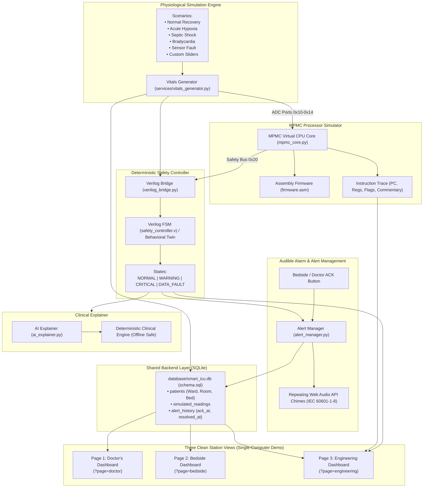

# 🏥 Smart ICU Guardian

> **Academic Educational Prototype Disclaimer**: This project is an educational engineering simulation designed for computer engineering and biomedical instrumentation study. All patient vitals and telemetry waveforms are simulated. This software is **not** a certified medical device and must never be used for clinical diagnostic or treatment decisions.

---

## 📖 Overview

**Smart ICU Guardian** is a complete, multi-station educational telemetry monitor and patient safety platform. It features a clean 3-page architecture designed for single-computer multi-tab demonstration:

1. **🩺 Doctor's Central Dashboard (`?page=doctor`)**:
   - Multi-patient ICU census table displaying 5 beds simultaneously.
   - Shows **Patient ID, Ward, Room, Bed, Heart Rate, SpO2, Respiratory Rate, Temperature, and Condition Status**.
   - Color-coded: **Green for NORMAL, Amber for WARNING, and Red for CRITICAL**.
   - Emergency alert card with exact Ward, Room, Bed location and trigger reason.
   - Repeating audible medical alarm (IEC 60601-1-8 patterns via HTML5 Web Audio API).
   - **ACKNOWLEDGE ALARM** button: silences audio immediately, while keeping visual alerts visible until condition resolution.
   - Continuous event duplicate prevention (records acknowledgement separately from recovery).
   - One-click links to open bedside monitors in separate tabs.

2. **🛌 Bedside Patient Dashboard (`?page=bedside`)**:
   - High-contrast, large-format clinical telemetry monitor for a single selected patient.
   - Displays **Heart Rate, SpO2, Respiratory Rate, Temperature**, and location (**Ward, Room, Bed, Patient ID**).
   - Clinical explanation card detailing physiological mechanisms and bedside nursing checks when abnormal.
   - Dedicated bedside alarm acknowledgement.
   - Minimalist clinical display: **Strictly no CPU registers, assembly traces, or engineering clutter**.

3. **⚙️ Biomedical Engineering Dashboard (`?page=engineering`)**:
   - **MPMC Virtual Processor**: Emulates embedded telemetry acquisition polling ADC ports `0x10`–`0x14` and driving the `0x20` bus, generating a visible step-by-step assembly instruction execution trace table.
   - **Verilog Hardware Safety Controller**: Synthesizable Verilog FSM (`safety_controller.v`) enforcing deterministic states (`NORMAL`, `WARNING`, `CRITICAL`, `DATA_FAULT`).
   - **Simulation Bridge**: Detects native Icarus Verilog (`iverilog`/`vvp`) if installed, and falls back gracefully to the verified cycle-exact Python Behavioral Twin without falsely claiming native execution.
   - **AI Clinical Explainer**: Strict deterministic safety isolation (AI never alters or determines alert severity) with an offline rule-based clinical engine.
   - **Scenario & Telemetry Injection**: Change scenarios on the fly (Normal Recovery, Hypoxia, Septic Shock, Bradycardia, Sensor Disconnect, Interactive Custom sliders).
   - **SQLite Database Viewer & CSV Exporter**.

---

## 🏗️ System Architecture



---

## 🖥️ Single-Computer Setup Instructions

The application is engineered to run on a single computer and be viewed across multiple browser tabs:

### 1. Requirements
- Windows, macOS, or Linux
- Python 3.10+ (Tested on Python 3.13)

### 2. Install Dependencies
Open PowerShell or Command Prompt in this folder:
```powershell
pip install -r requirements.txt
```

### 3. Launch the Server
```powershell
streamlit run app.py
```
Streamlit will start on `http://localhost:8501`.

### 4. Open Multiple Station Tabs
Open your web browser (Chrome, Edge, or Firefox) and open these separate tabs:
- **Tab 1 — Doctor's Dashboard**:
  `http://localhost:8501/?page=doctor`
- **Tab 2 — Bedside Dashboard (Patient P101)**:
  `http://localhost:8501/?page=bedside&patient_id=P101`
- **Tab 3 — Engineering & Architecture**:
  `http://localhost:8501/?page=engineering`

All three tabs share the same real-time backend SQLite database and telemetry engine!

---

## 🧪 Demonstration Workflow

1. **Observe Multi-Patient Census (Tab 1: Doctor's Dashboard)**:
   - View all 5 beds across `ICU-North` and `ICU-South`.
   - All readings update continuously in real time.
2. **Examine Critical Alert & Repeating Audio Alarm**:
   - Marcus Sterling (`P102`) or Sophia Lin (`P103`) experience Acute Hypoxia or Septic Shock.
   - The affected row is highlighted in flashing red.
   - An emergency banner announces: **Ward: ICU-North | Room: 101 | Bed: Bed-B | Patient: P102**.
   - The browser emits a repeating IEC 60601-1-8 high-priority alarm sound.
3. **Acknowledge the Alarm**:
   - Click the **🔔 ACK ALARM** button on Tab 1 or Tab 2.
   - The audible alarm silences immediately.
   - The visual alert card and red highlight remain visible (`resolved = 0`) until patient vitals recover.
   - Acknowledgement timestamp is saved in SQLite (`acknowledged_at`).
   - Duplicate alerts are prevented for the continuous event.
4. **Inspect the Bedside Monitor (Tab 2: Bedside Dashboard)**:
   - Displays large readable parameters without any developer clutter.
   - Shows clinical pathophysiological explanation and bedside nursing checks.
5. **Inspect Hardware Architecture (Tab 3: Engineering Dashboard)**:
   - View the step-by-step MPMC Assembly instruction trace.
   - Inspect Verilog FSM states, pin outputs, and run the hardware testbench.

---

## 🔬 Running Automated Tests

Run the complete test suite with `pytest`:
```powershell
pytest -v
```

All 14 unit and integration tests validate:
- SQLite initialization, schema migrations, and patient locations (**Ward, Room, Bed**).
- Continuous event duplicate alert prevention.
- Separate recording of clinician acknowledgement vs recovery/resolution.
- Realistic physiological vital sign progression across all scenarios.
- MPMC instruction decoding, register state, ALU flags, and execution trace generation.
- Verilog FSM states (`NORMAL`, `WARNING`, `CRITICAL`, `DATA_FAULT`).
- Verilog bridge toolchain transparency (never fakes native execution).
- Audible alarm repeating intervals and clinician acknowledgement.
- AI Clinical Explainer fallback safety isolation and offline operation.

---

## 📁 Repository Structure

```
smart-icu-guardian-clean/
├── app.py                               # 3-Page Streamlit Telemetry Cockpit (Doctor, Bedside, Engineering)
├── requirements.txt                     # Python dependencies
├── conftest.py                          # Pytest configuration
├── README.md                            # Comprehensive documentation
├── config/
│   └── thresholds.json                  # Vital signs threshold specifications
├── database/
│   ├── schema.sql                       # SQLite relational schema (with Ward, Room, Bed, Ack/Resolve timestamps)
│   ├── db.py                            # SQLite persistence & multi-patient synchronization
│   └── smart_icu.db                     # Auto-initialized SQLite database
├── services/
│   ├── vitals_generator.py              # Multi-patient physiological simulator & scenarios
│   ├── alert_manager.py                 # Multi-patient alarm manager & repeating audio synthesizer
│   └── ai_explainer.py                  # Clinical explainer & offline fallback
├── simulator/
│   ├── mpmc/
│   │   ├── mpmc_core.py                 # MPMC CPU simulator & trace logger
│   │   └── firmware.asm                 # Assembly firmware for ADC polling
│   └── verilog/
│       ├── verilog/
│       │   ├── safety_controller.v      # Synthesizable Verilog FSM RTL
│       │   └── testbench/
│       │       └── safety_controller_tb.v # Verilog simulation testbench
│       └── integration/
│           ├── verilog_bridge.py        # Hardware bridge & toolchain detection
│           └── behavioral_fsm.py        # Cycle-exact Python FSM twin
└── tests/
    ├── test_smart_icu.py                # Core unit & integration test suites
    └── test_multi_station.py            # Multi-station census, location & duplicate prevention tests
```

---

## 📜 License
Developed for educational, university, and instructional research purposes.
